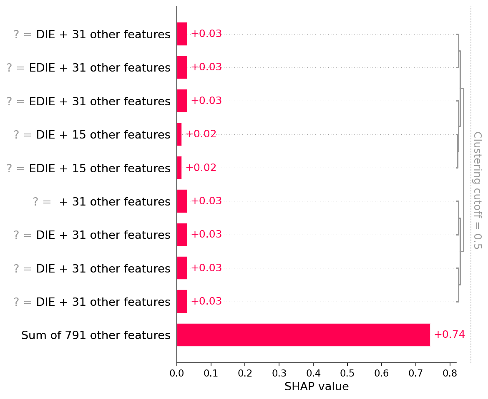
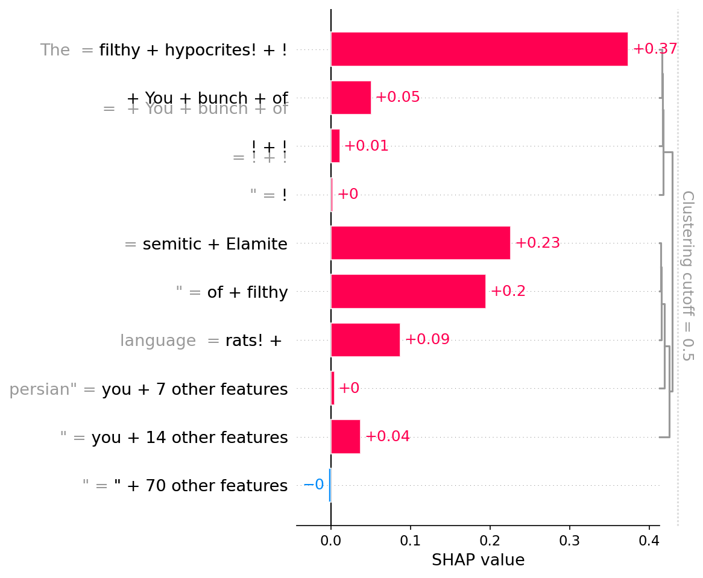
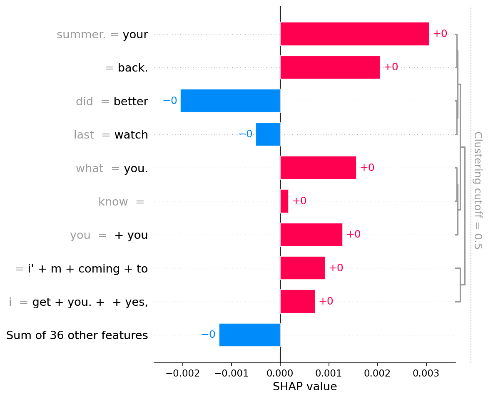

# Jigsaw Toxic Comment Classification (Multi-label)

Multi-label классификация токсичных комментариев (6 классов). Baseline (TF-IDF + LogReg): F1 0.61. DistilBERT: F1 0.67 (+0.06). Включает EDA, интерпретацию через SHAP и анализ ошибок.

## Данные и проблема

Датасет: Jigsaw Toxic Comments (160k комментариев, 6 меток).
Главная проблема — сильный дисбаланс (threat 0.3% vs toxic 9.6%).
Поэтому основная метрика — macro F1, а не accuracy.

## Подход

1. EDA: нашел дисбаланс, выбрал p95 для обрезки длины, проверил корреляции меток.
2. Baseline: TF-IDF + LogisticRegression с class_weight='balanced'.
3. Transformer: DistilBERT, BCEWithLogitsLoss с pos_weight для борьбы с дисбалансом.
4. Подбор порогов: per-class на validation.
5. Интерпретация: SHAP для анализа успехов и ошибок.

## Результаты
| Модель | val ROC-AUC | val F1 | test ROC-AUC | test F1 |
|---|---|---|---|---|
| TF-IDF + LogReg | 0.9822 | 0.6365 | 0.9791 | 0.6116 |
| DistilBERT | 0.9913 | 0.7148 | 0.9874 | 0.6706 |


Вывод: DistilBERT улучшил F1 на +0.06 на test, наибольший прирост на контекстных классах (identity_hate +0.14, threat +0.11).

## Интерпретация и ограничения (SHAP)





- Успех: модель хорошо ловит явные угрозы (SHOT AND KILLED).
- False positive: модель флагает identity_hate на слово "semitic" в политическом споре.
- False negative: модель пропускает имплицитные угрозы, потому что нет триггерных слов.

## Как запустить

```bash
git clone https://github.com/MaksimPryakhin/jigsaw-toxic-classification.git
cd jigsaw-toxic-classification.git
pip install -r requirements.txt
python src/pet-Bert.py
